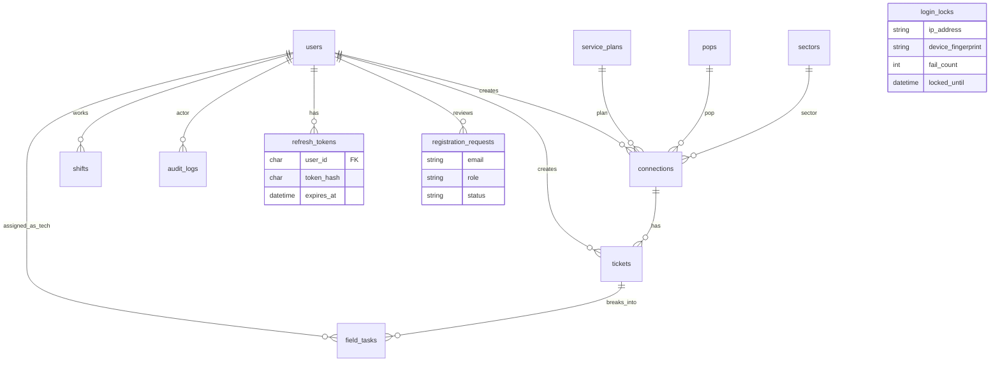

# ISP Operations & Field Dispatch API

Express + MySQL backend for ISP ops: broadband connections, complaint tickets, field-task dispatch with schedule conflict checks, status ranks, and an append-only audit trail.

| | |
|---|---|
| Stack | Node.js 18+, Express 5, MySQL 8 |
| Auth | Access JWT + refresh token; Zod validation; progressive login lockout |
| Roles | `manager` · `support` · `technician` |
| **Live API** | **https://revatix-assignment-api.onrender.com/api/v1** |
| Repo | https://github.com/Vibhor1603/revatix-assignment |
| DB | Aiven MySQL (`DB_SSL=true`) |

Send device id on auth calls when possible: `X-Device-Fingerprint: <stable-client-id>`.

---

## Features

- Connections with plan, optional static IP, POP, sector, status (`Pending` → `Terminated`)
- Catalog tables for plans / POPs / sectors (hybrid FKs on connections)
- Tickets with priority + SLA; field tasks under each ticket
- Multi-tech dispatch = multiple tasks (one technician per task)
- Shift windows + overlap / overnight rejection on assign
- Status ranks stored in MySQL for tickets and tasks
- Audit row on every important write
- Register as `manager` or `technician` → **pending until a manager approves**
- Login protected by IP+device rate limits and progressive lockout

---

## Quick start

```bash
cp .env.example .env          # set DB_* ; use DB_SSL=true for Aiven
npm install
npm run db:schema             # applies schema + auth security tables
npm run seed
npm run dev                   # http://localhost:4000/api/v1
```

Docker MySQL (optional):

```bash
docker run --name isp-mysql -e MYSQL_ROOT_PASSWORD=root -e MYSQL_DATABASE=isp_ops \
  -p 3306:3306 -d mysql:8
```

---

## Environment

| Variable | Purpose |
|----------|---------|
| `DB_HOST` `DB_PORT` `DB_USER` `DB_PASSWORD` `DB_NAME` | MySQL connection |
| `DB_SSL` | `true` for Aiven |
| `DB_SSL_CA` | Optional path to Aiven CA PEM |
| `JWT_SECRET` | HS256 signing secret |
| `JWT_ACCESS_EXPIRES_IN` | Access token TTL (default `15m`) |
| `JWT_REFRESH_DAYS` | Refresh token TTL in days (default `7`) |
| `PORT` | Local port (Render sets its own) |

Never commit `.env`.

---

## Test users (`npm run seed`)

Password for all: `Password123!`

| Email | Role |
|-------|------|
| `manager@isp.local` | manager |
| `support@isp.local` | support |
| `tech@isp.local` | technician |

---

## Auth security

### Access + refresh

- Login / refresh return `accessToken` (short JWT) and `refreshToken` (opaque, stored hashed).
- Use `Authorization: Bearer <accessToken>` on protected routes.
- `POST /auth/refresh` rotates refresh tokens (old one is revoked).
- `POST /auth/logout` revokes a refresh token.

### Progressive login lockout (IP + device)

Failed logins are counted per **client IP + device fingerprint**.

| Failures | Lock |
|----------|------|
| 1–2 | none |
| 3–4 | 30 seconds |
| 5–7 | 2 minutes |
| 8–9 | 15 minutes |
| 10+ | 1 hour |

Fingerprint source: header `X-Device-Fingerprint`, or a hash of User-Agent / Accept-Language if missing. Successful login clears the lock.

### Flood limits

Separate sliding windows (same IP+device key): login 20/min, refresh 30/min, register 10 / 15 min.

### Registration approval

1. `POST /auth/register` with role `manager` or `technician` → status `pending` (cannot log in yet).
2. Manager lists requests: `GET /auth/registration-requests?status=pending`.
3. Manager `POST .../approve` creates the user, or `.../reject` closes the request.

---

## Project structure

```
src/   app, routes, controllers, services, validators, middleware, db, seed
sql/   schema.sql + migration_auth_security.sql
scripts/  apply-schema, verify-api, curl-sweep
```

---

## ER diagram



Technicians are `users` with `role = technician`. Sector is independent of POP. Soft delete via `deleted_at`.

Full DDL: [`sql/schema.sql`](sql/schema.sql).

---

## Indexes (high value)

| Table | Index | Why |
|-------|--------|-----|
| `users` | UNIQUE email; (role, deleted_at) | Login / tech list |
| `pops` | UNIQUE code | Stable POP ids |
| `connections` | status, plan_id, pop_id, sector_id | Filters |
| `tickets` | connection_id, status | Lists / guards |
| `field_tasks` | (technician_id, scheduled_start, scheduled_end) | Overlap checks |
| `shifts` | (technician_id, shift_date) | Assign shift lookup |
| `audit_logs` | (entity_type, entity_id, created_at), action | History filters |
| `login_locks` | UNIQUE (ip, device) | Lockout lookup |
| `refresh_tokens` | UNIQUE token_hash; user_id | Refresh / revoke |

---

## Status ranks

**Connection:** Pending 1 · Active 2 · Suspended 3 · Terminated 4  

**Ticket:** Open 1 · In-Progress 2 · Field Visit 3 · Resolved 4 · Closed 5  

**Task:** same as ticket + Cancelled 6  

Closing a ticket is blocked while any task is still Open / In-Progress / Field Visit / Resolved.

---

## Roles

| Capability | manager | support | technician |
|------------|---------|---------|------------|
| Catalog + connections write | yes | — | — |
| Tickets / tasks create & assign | yes | yes | — |
| Approve registrations | yes | — | — |
| Task status (assigned) | yes | yes | own only |
| Audit read | yes | yes | — |

---

## API conventions

Base path: `/api/v1`

**Success:** raw JSON (`201` on creates).  
**Lists:** `{ items, page, pageSize: 10, total }`  
**Errors:** `{ error, message, details? }` — `400` / `401` / `403` / `404` / `409` / `429`

---

## API reference

### Auth

| Method | Path | Who | Purpose |
|--------|------|-----|---------|
| POST | `/auth/login` | public | Access + refresh tokens |
| POST | `/auth/refresh` | public | Rotate tokens |
| POST | `/auth/logout` | public | Revoke refresh token |
| POST | `/auth/register` | public | Submit approval request (`manager` \| `technician`) |
| GET | `/auth/me` | JWT | Current user |
| GET | `/auth/registration-requests` | manager | List requests (`?status=&page=`) |
| POST | `/auth/registration-requests/:id/approve` | manager | Create user from request |
| POST | `/auth/registration-requests/:id/reject` | manager | Reject request |

**Login request / response**

```json
// POST /auth/login
{ "email": "manager@isp.local", "password": "Password123!" }

// 200
{
  "accessToken": "<jwt>",
  "refreshToken": "<opaque>",
  "tokenType": "Bearer",
  "expiresIn": "15m",
  "user": { "id": "...", "role": "manager", "email": "..." }
}
```

**Register request**

```json
{
  "name": "New Tech",
  "email": "newtech@example.com",
  "password": "Password123!",
  "role": "technician",
  "employeeCode": "TECH-010",
  "phone": "9999999999"
}
```

**Refresh**

```json
{ "refreshToken": "<opaque>" }
```

DB notes: login checks `login_locks` then `users`; refresh looks up hashed token, revokes it, issues a new pair; approve inserts into `users` and audits.

### Catalog

| Resource | Methods | Roles (write / read) |
|----------|---------|----------------------|
| `/plans` | POST GET GET/:id PATCH DELETE | manager / manager+support |
| `/pops` | same | manager / manager+support |
| `/sectors` | same | manager / manager+support |

Plan body: `{ "name", "bandwidthMbps", "price" }`  
POP body: `{ "code", "name", "location?" }`  
Sector body: `{ "name", "geoDescription?" }`

### Connections `/connections`

| Method | Roles | Notes |
|--------|-------|-------|
| POST | manager | Requires existing plan/pop/sector |
| GET | manager, support | Filters: `status` `planId` `popId` `sectorId` `page` |
| GET/:id PATCH DELETE | manager | Soft delete |
| PATCH /:id/status | manager | Any status; updates `status_rank` + audit |

### Tickets `/tickets`

| Method | Roles | Notes |
|--------|-------|-------|
| POST | manager, support | Blocked if connection missing/Terminated |
| GET / GET/:id | manager, support, technician | Tasks not embedded |
| PATCH / PATCH /:id/status | manager, support | Close blocked if tasks still open |

### Tasks

| Method | Path | Roles |
|--------|------|-------|
| POST/GET | `/tickets/:ticketId/tasks` | create: manager+support; list: +technician |
| GET/PATCH | `/tasks/:id` | patch: manager+support |
| PATCH | `/tasks/:id/status` | +technician if assignee |
| POST | `/tasks/:id/assign` | manager+support — conflict checks |
| POST | `/tasks/:id/unassign` \| `/cancel` | manager+support |

Assign body: `{ "technicianId", "scheduledStart", "scheduledEnd" }` (same calendar day).

### Technicians `/technicians`

List/create techs; manage shifts (`POST/GET/DELETE .../shifts`). Overnight and overlapping shifts → `400`.

### Audit `/audit`

`GET` for manager+support. Query: `entityType` `entityId` `action` `actorUserId` `page`.

---

## Edge cases

| Case | Result |
|------|--------|
| Bad password / unknown email | `401` (same message) |
| Zod fail | `400` + `details` |
| Progressive lock active | `429` with unlock time |
| Login/register flood | `429` rate limit |
| Expired / revoked refresh | `401` |
| Refresh device mismatch | `401` when fingerprint was bound |
| Duplicate / pending register email | `409` |
| Non-manager approve/reject | `403` |
| Ticket on Terminated connection | `400` |
| Close ticket with open tasks | `400` |
| Assign outside shift / overlap / overnight | `400` |
| Overlap with Closed/Cancelled task | allowed |

Assign runs in a transaction: load task+tech → validate window → require covering shift → reject active overlaps → update + audit (`task_assigned` / `task_reassigned`).

---

## Scripts

| Command | Purpose |
|---------|---------|
| `npm run dev` / `start` | Run API |
| `npm run db:schema` | Apply SQL (including auth tables) |
| `npm run seed` | Seed demo users |
| `npm run verify` | Automated checks |
| `bash scripts/curl-sweep.sh` | Full curl sweep |

Live sweep:

```bash
API_BASE=https://revatix-assignment-api.onrender.com/api/v1 bash scripts/curl-sweep.sh
```

---

## Deploy

- **Render (free):** https://revatix-assignment-api.onrender.com  
- Dashboard service: `revatix-assignment-api` (auto-deploy from `main`)
- Env on Render must include Aiven `DB_*`, `DB_SSL=true`, `JWT_SECRET`, `JWT_ACCESS_EXPIRES_IN`, `JWT_REFRESH_DAYS`
- Blueprint: [`render.yaml`](render.yaml)

Free instances sleep when idle; first request after sleep can take ~30–60s.

---

## License

ISC
