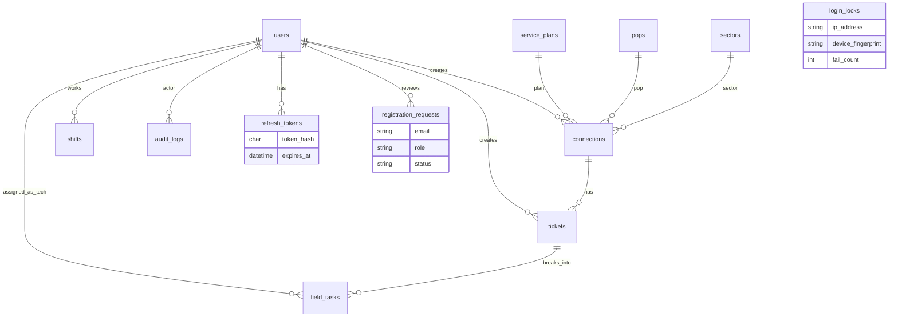

# ISP Operations & Field Dispatch API

<p align="center">
  <strong>Node.js · Express · MySQL</strong><br/>
  Broadband connections · complaint tickets · field dispatch · audit trail
</p>

<p align="center">
  <a href="https://revatix-assignment-api.onrender.com/api/v1"></a>
  <a href="https://github.com/Vibhor1603/revatix-assignment"></a>
  
  
</p>

> **Live base URL:** [`https://revatix-assignment-api.onrender.com/api/v1`](https://revatix-assignment-api.onrender.com/api/v1)

> **Important — Render free-tier sleep:** Free Render apps **sleep after inactivity**. If someone reviews the API after **3 or more days** (or any long idle period), the **first request can take a few minutes** while the instance wakes up. Prefer waiting / retrying once before concluding the deploy is broken. Structured logs appear in the Render dashboard once the service is warm.

---

## What this API does

Managers and support staff can:

1. Register subscriber **connections** (plan, optional static IP, POP, sector, deployment status)
2. Open **tickets** (priority + SLA) against a connection
3. Split work into **field tasks** and assign technicians with **schedule conflict checks**
4. Move ticket/task **status ranks** in MySQL
5. Keep an **append-only audit log** of important changes

Self-registration for `manager` / `technician` is supported, but accounts stay **pending until a manager approves**.

---

## Quick links

| Resource | URL |
|----------|-----|
| **Live API** | https://revatix-assignment-api.onrender.com/api/v1 |
| Repository | https://github.com/Vibhor1603/revatix-assignment |
| Schema | [`sql/schema.sql`](sql/schema.sql) |

Prefer sending `X-Device-Fingerprint: <stable-client-id>` on auth requests (used for rate limits + lockout).

---

## Features

| Area | Details |
|------|---------|
| Connections | Plan + POP + sector + optional static IP + status |
| Catalog | Hybrid lookup tables for plans, POPs, sectors |
| Tickets & tasks | Master ticket → many field tasks (one tech per task) |
| Dispatch rules | Shifts, no overnight, overlap rejection, reassign/unassign/cancel |
| Auth | Access JWT + rotating refresh token |
| Hardening | Progressive IP+device lockout, auth rate limits |
| Registration | Pending requests; manager approve / reject |
| Observability | **Pino** JSON logs (request + domain events) for Render |

---

## Quick start

```bash
cp .env.example .env          # set DB_*; use DB_SSL=true for Aiven
npm install
npm run db:schema             # schema + auth/security tables
npm run seed
npm run dev                   # http://localhost:4000/api/v1
```

Optional local MySQL:

```bash
docker run --name isp-mysql -e MYSQL_ROOT_PASSWORD=root -e MYSQL_DATABASE=isp_ops \
  -p 3306:3306 -d mysql:8
```

---

## Environment

| Variable | Purpose |
|----------|---------|
| `DB_HOST` `DB_PORT` `DB_USER` `DB_PASSWORD` `DB_NAME` | MySQL |
| `DB_SSL` | `true` on Aiven |
| `DB_SSL_CA` | Optional Aiven CA path |
| `JWT_SECRET` | Access-token signing secret |
| `JWT_ACCESS_EXPIRES_IN` | Access TTL (default `15m`) |
| `JWT_REFRESH_DAYS` | Refresh TTL days (default `7`) |
| `LOG_LEVEL` | `info` (prod default) / `debug` (local) |
| `PORT` | Local only (Render injects its own) |

`.env` is gitignored — never commit secrets.

---

## Test users

Seeded by `npm run seed` · password for all: **`Password123!`**

| Email | Role |
|-------|------|
| `manager@isp.local` | manager |
| `support@isp.local` | support |
| `tech@isp.local` | technician |

---

## Logging (Render-friendly)

Production uses **[Pino](https://getpino.io/)** structured JSON logs (no ad-hoc `console.log` in request paths).

| What is logged | Level |
|----------------|-------|
| Every HTTP request (method, url, status, duration) | info / warn / error |
| Login success & failures (no passwords) | info / warn |
| Progressive lockouts & failed-attempt counters | warn |
| Refresh rotate / revoke / mismatch | info / warn |
| Registration submit / approve / reject | info |
| Task assign success & conflict rejects | info / warn |
| MySQL pool create / DNS / pool failures | info / warn / error |
| 4xx/5xx via error middleware (stack on 5xx) | warn / error |
| Process signals & fatal crashes | warn / fatal |

**Secrets are redacted** (passwords, Authorization, tokens). On Render: open the service → **Logs**.

Locally, logs are pretty-printed; on Render they stay JSON for searchability.

---

## Auth security (short)

- **Access JWT** (short) + **opaque refresh token** (hashed in DB, rotated on refresh)
- **Progressive lockout** by IP + device fingerprint: 3→30s, 5→2m, 8→15m, 10→1h
- **Rate limits** (same key): login 20/min · refresh 30/min · register 10 / 15 min
- **Register** (`manager` \| `technician`) → pending → manager approve/reject

```http
POST /api/v1/auth/login
X-Device-Fingerprint: my-device-uuid
Content-Type: application/json

{ "email": "manager@isp.local", "password": "Password123!" }
```

Response includes `accessToken`, `refreshToken`, `expiresIn`, `user`.

---

## Project structure

```text
src/
  utils/logger.js          # Pino singleton
  middleware/              # auth, roles, Zod, rate limits, errors
  services/                # business rules + SQL
  routes/ controllers/ validators/
sql/schema.sql
scripts/                   # schema apply, verify, curl sweep
```

---

## ER diagram



Technicians are `users` (`role = technician`). Soft delete via `deleted_at`. Full DDL: [`sql/schema.sql`](sql/schema.sql).

---

## Indexes (high-value)

| Table | Index | Why |
|-------|--------|-----|
| `users` | UNIQUE email · (role, deleted_at) | Login / tech list |
| `pops` | UNIQUE code | Stable POP codes |
| `connections` | status, plan_id, pop_id, sector_id | Filters |
| `tickets` | connection_id, status | Lists / close guards |
| `field_tasks` | (technician_id, scheduled_*) | Overlap checks |
| `shifts` | (technician_id, shift_date) | Assign validation |
| `audit_logs` | entity + created_at, action | History filters |
| `login_locks` | UNIQUE (ip, device) | Lockout |
| `refresh_tokens` | UNIQUE token_hash | Refresh lookup |

---

## Status ranks

| Entity | Values (rank) |
|--------|----------------|
| Connection | Pending 1 · Active 2 · Suspended 3 · Terminated 4 |
| Ticket | Open 1 · In-Progress 2 · Field Visit 3 · Resolved 4 · Closed 5 |
| Task | same as ticket + **Cancelled 6** |

Cannot **Close** a ticket while any task is still Open / In-Progress / Field Visit / Resolved.

---

## Roles

| Capability | manager | support | technician |
|------------|:-------:|:-------:|:----------:|
| Catalog / connections write | yes | — | — |
| Tickets / task assign | yes | yes | — |
| Approve registrations | yes | — | — |
| Update assigned task status | yes | yes | own |
| Audit read | yes | yes | — |

---

## API conventions

- Base path: **`/api/v1`**
- Auth header: `Authorization: Bearer <accessToken>`
- Success: raw JSON (`201` on create)
- Lists: `{ items, page, pageSize: 10, total }`
- Errors: `{ error, message, details? }` → `400` `401` `403` `404` `409` `429`

---

## API map

### Auth

| Method | Path | Access | Purpose |
|--------|------|--------|---------|
| POST | `/auth/login` | public | Access + refresh |
| POST | `/auth/refresh` | public | Rotate tokens |
| POST | `/auth/logout` | public | Revoke refresh |
| POST | `/auth/register` | public | Pending signup (`manager` \| `technician`) |
| GET | `/auth/me` | JWT | Current user |
| GET | `/auth/registration-requests` | manager | List (`?status=&page=`) |
| POST | `/auth/registration-requests/:id/approve` | manager | Create user |
| POST | `/auth/registration-requests/:id/reject` | manager | Reject |

### Domain modules

| Module | Prefix | Notes |
|--------|--------|-------|
| Plans / POPs / Sectors | `/plans` `/pops` `/sectors` | Manager write; support read |
| Connections | `/connections` | Filters: status, planId, popId, sectorId |
| Tickets | `/tickets` | No ticket on Terminated connection |
| Tasks | `/tickets/:id/tasks`, `/tasks/:id` | assign / unassign / cancel |
| Technicians | `/technicians` | Shifts CRUD |
| Audit | `/audit` | Filter by entity / action / actor |

**Assign body:** `{ "technicianId", "scheduledStart", "scheduledEnd" }` — same calendar day; must fit a shift; no overlap with active tasks.

---

## Edge cases (selected)

| Situation | API result |
|-----------|------------|
| Bad credentials | `401` (generic message) |
| Progressive lock / flood | `429` |
| Expired / revoked refresh | `401` |
| Pending register email again | `409` |
| Close ticket with open tasks | `400` |
| Assign outside shift / overlap / overnight | `400` |
| Overlap with Closed/Cancelled task | allowed |

---

## Scripts

| Command | Purpose |
|---------|---------|
| `npm run dev` / `start` | Run API |
| `npm run db:schema` | Apply SQL |
| `npm run seed` | Demo users |
| `npm run verify` | Automated checks |
| `bash scripts/curl-sweep.sh` | Full curl sweep |

```bash
API_BASE=https://revatix-assignment-api.onrender.com/api/v1 bash scripts/curl-sweep.sh
```

---

## Deploy

| | |
|---|---|
| **Live** | https://revatix-assignment-api.onrender.com |
| Host | Render free web service `revatix-assignment-api` |
| Database | Aiven MySQL (`DB_SSL=true`) |
| Blueprint | [`render.yaml`](render.yaml) |

Set Render env: Aiven `DB_*`, `DB_SSL=true`, `JWT_SECRET`, `JWT_ACCESS_EXPIRES_IN`, `JWT_REFRESH_DAYS`, optional `LOG_LEVEL=info`.

---

## License

ISC
