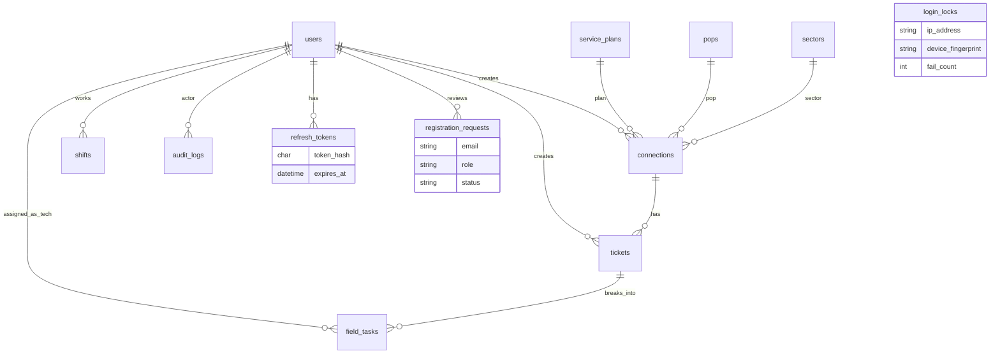

# ISP Operations & Field Dispatch API

<p align="center">
  <strong>Node.js · Express · MySQL</strong><br/>
  Broadband connections · complaint tickets · field dispatch · audit trail
</p>

<p align="center">
  <a href="https://revatix-assignment-api.onrender.com/api/v1"></a>
  <a href="https://github.com/Vibhor1603/revatix-assignment"></a>
  
  
</p>

> **Live base URL:** [`https://revatix-assignment-api.onrender.com/api/v1`](https://revatix-assignment-api.onrender.com/api/v1)

> **Important — Render free-tier sleep:** Free Render apps **sleep after inactivity**. If someone reviews the API after **3 or more days** (or any long idle period), the **first request can take a few minutes** while the instance wakes up. Prefer waiting / retrying once before concluding the deploy is broken. Structured logs appear in the Render dashboard once the service is warm.

---

## Table of contents

1. [Overview](#1-overview)
2. [Quick start](#2-quick-start)
3. [Environment](#3-environment)
4. [Test users](#4-test-users)
5. [Conventions](#5-conventions)
6. [Roles & permissions](#6-roles--permissions)
7. [Status ranks](#7-status-ranks)
8. [API reference](#8-api-reference)
   - [8.1 Auth](#81-auth)
   - [8.2 Plans](#82-plans)
   - [8.3 POPs](#83-pops)
   - [8.4 Sectors](#84-sectors)
   - [8.5 Connections](#85-connections)
   - [8.6 Tickets](#86-tickets)
   - [8.7 Field tasks](#87-field-tasks)
   - [8.8 Technicians & shifts](#88-technicians--shifts)
   - [8.9 Audit](#89-audit)
9. [Auth security](#9-auth-security)
10. [Logging](#10-logging)
11. [Data model](#11-data-model)
12. [Scripts & deploy](#12-scripts--deploy)

---

## 1. Overview

Managers and support staff can:

1. Maintain **catalog** data (plans, POPs, sectors)
2. Register subscriber **connections** (plan, optional static IP, POP, sector, status)
3. Open **tickets** (priority + SLA) against a connection
4. Split work into **field tasks** and assign technicians with **schedule conflict checks**
5. Move ticket/task **status ranks** stored in MySQL
6. Read an **append-only audit log** of important changes

Self-registration for `manager` / `technician` is supported; accounts stay **pending until a manager approves**.

| Resource | URL |
|----------|-----|
| **Live API** | https://revatix-assignment-api.onrender.com/api/v1 |
| Repository | https://github.com/Vibhor1603/revatix-assignment |
| Schema | [`sql/schema.sql`](sql/schema.sql) |

---

## 2. Quick start

```bash
cp .env.example .env          # set DB_*; use DB_SSL=true for Aiven
npm install
npm run db:schema             # schema + auth/security tables
npm run seed
npm run dev                   # http://localhost:4000/api/v1
```

Optional local MySQL:

```bash
docker run --name isp-mysql -e MYSQL_ROOT_PASSWORD=root -e MYSQL_DATABASE=isp_ops \
  -p 3306:3306 -d mysql:8
```

---

## 3. Environment

| Variable | Purpose |
|----------|---------|
| `DB_HOST` `DB_PORT` `DB_USER` `DB_PASSWORD` `DB_NAME` | MySQL |
| `DB_SSL` | `true` on Aiven |
| `DB_SSL_CA` | Optional Aiven CA path |
| `JWT_SECRET` | Access-token signing secret |
| `JWT_ACCESS_EXPIRES_IN` | Access TTL (default `15m`) |
| `JWT_REFRESH_DAYS` | Refresh TTL days (default `7`) |
| `LOG_LEVEL` | `info` (prod) / `debug` (local) |
| `PORT` | Local only (Render injects its own) |

`.env` is gitignored — never commit secrets.

---

## 4. Test users

Seeded by `npm run seed` · password for all: **`Password123!`**

| Email | Role |
|-------|------|
| `manager@isp.local` | manager |
| `support@isp.local` | support |
| `tech@isp.local` | technician |

---

## 5. Conventions

| Rule | Detail |
|------|--------|
| Base path | `/api/v1` |
| Auth header | `Authorization: Bearer <accessToken>` |
| Device header | Prefer `X-Device-Fingerprint: <stable-client-id>` on auth calls |
| Success | Raw JSON body · `201` on create |
| Lists | `{ items, page, pageSize: 10, total }` |
| Errors | `{ error, message, details? }` → `400` `401` `403` `404` `409` `429` |
| IDs | UUID strings |
| Soft delete | Resources use `deleted_at` (no hard deletes in domain tables) |

**Access legend used below**

| Label | Meaning |
|-------|---------|
| public | No JWT |
| JWT | Any authenticated role |
| M | manager |
| S | support |
| T | technician |

---

## 6. Roles & permissions

| Capability | M | S | T |
|------------|:-:|:-:|:-:|
| Catalog write (plans / POPs / sectors) | yes | — | — |
| Catalog / connections read | yes | yes | — |
| Connections write / soft-delete | yes | — | — |
| Tickets write · task create / assign | yes | yes | — |
| Tickets / tasks read | yes | yes | yes |
| Update assigned task status | yes | yes | own |
| Technicians create · shifts write | yes | — | — |
| Technicians / shifts read | yes | yes | shifts: yes |
| Approve / reject registrations | yes | — | — |
| Audit read | yes | yes | — |

---

## 7. Status ranks

| Entity | Values (rank) |
|--------|----------------|
| Connection | Pending `1` · Active `2` · Suspended `3` · Terminated `4` |
| Ticket | Open `1` · In-Progress `2` · Field Visit `3` · Resolved `4` · Closed `5` |
| Task | same as ticket + **Cancelled `6`** |

Cannot **Close** a ticket while any task is still Open / In-Progress / Field Visit / Resolved.

---

## 8. API reference

All paths are relative to **`/api/v1`**.

---

### 8.1 Auth

| Method | Path | Access | Purpose |
|--------|------|--------|---------|
| `POST` | `/auth/login` | public | Issue access + refresh tokens |
| `POST` | `/auth/refresh` | public | Rotate refresh → new token pair |
| `POST` | `/auth/logout` | public | Revoke refresh token |
| `POST` | `/auth/register` | public | Submit pending signup (`manager` \| `technician`) |
| `GET` | `/auth/me` | JWT | Current user profile |
| `GET` | `/auth/registration-requests` | M | List requests (`?status=&page=`) |
| `POST` | `/auth/registration-requests/:id/approve` | M | Approve → create user |
| `POST` | `/auth/registration-requests/:id/reject` | M | Reject request |

<details>
<summary><strong>Bodies & examples</strong></summary>

**Login**

```http
POST /api/v1/auth/login
X-Device-Fingerprint: my-device-uuid
Content-Type: application/json

{ "email": "manager@isp.local", "password": "Password123!" }
```

Response: `{ accessToken, refreshToken, expiresIn, user }`

**Refresh** — `{ "refreshToken": "..." }`  
**Logout** — `{ "refreshToken": "..." }` (optional)  
**Register** — `{ "name", "email", "password", "role": "manager"|"technician", "employeeCode?", "phone?" }`  
**List registrations** — query: `?status=pending|approved|rejected&page=1`  
**Approve / reject** — optional body `{ "note": "..." }`

</details>

---

### 8.2 Plans

Service-plan catalog. Manager writes; manager + support read.

| Method | Path | Access | Purpose |
|--------|------|--------|---------|
| `POST` | `/plans` | M | Create plan |
| `GET` | `/plans` | M S | List (`?page=`) |
| `GET` | `/plans/:id` | M S | Get one |
| `PATCH` | `/plans/:id` | M | Update fields |
| `DELETE` | `/plans/:id` | M | Soft-delete |

**Create body**

```json
{
  "name": "100 Mbps Fiber",
  "bandwidthMbps": 100,
  "price": 999
}
```

`PATCH` accepts any subset of those fields.

---

### 8.3 POPs

Point-of-presence catalog.

| Method | Path | Access | Purpose |
|--------|------|--------|---------|
| `POST` | `/pops` | M | Create POP |
| `GET` | `/pops` | M S | List (`?page=`) |
| `GET` | `/pops/:id` | M S | Get one |
| `PATCH` | `/pops/:id` | M | Update |
| `DELETE` | `/pops/:id` | M | Soft-delete |

**Create body**

```json
{
  "code": "POP-BLR-01",
  "name": "Bangalore Central",
  "location": "MG Road"
}
```

`code` is unique. `location` is optional.

---

### 8.4 Sectors

Coverage-sector catalog.

| Method | Path | Access | Purpose |
|--------|------|--------|---------|
| `POST` | `/sectors` | M | Create sector |
| `GET` | `/sectors` | M S | List (`?page=`) |
| `GET` | `/sectors/:id` | M S | Get one |
| `PATCH` | `/sectors/:id` | M | Update |
| `DELETE` | `/sectors/:id` | M | Soft-delete |

**Create body**

```json
{
  "name": "Sector 12",
  "geoDescription": "North tower coverage"
}
```

`geoDescription` is optional.

---

### 8.5 Connections

Subscriber broadband lines. Linked to plan + POP + sector.

| Method | Path | Access | Purpose |
|--------|------|--------|---------|
| `POST` | `/connections` | M | Create connection |
| `GET` | `/connections` | M S | List with filters |
| `GET` | `/connections/:id` | M S | Get one |
| `PATCH` | `/connections/:id` | M | Update fields |
| `PATCH` | `/connections/:id/status` | M | Change status only |
| `DELETE` | `/connections/:id` | M | Soft-delete |

**List query:** `?page=&status=&planId=&popId=&sectorId=`  
`status` ∈ `Pending` · `Active` · `Suspended` · `Terminated`

**Create body**

```json
{
  "customerName": "Asha Rao",
  "phone": "+919876543210",
  "email": "asha@example.com",
  "address": "12 Residency Road",
  "planId": "<uuid>",
  "popId": "<uuid>",
  "sectorId": "<uuid>",
  "staticIp": "203.0.113.10",
  "status": "Pending"
}
```

`email`, `address`, `staticIp`, `status` are optional (`status` defaults to `Pending`).  
**Status body:** `{ "status": "Active" }`

---

### 8.6 Tickets

Master complaint tickets against a connection. Cannot create on a **Terminated** connection.

| Method | Path | Access | Purpose |
|--------|------|--------|---------|
| `POST` | `/tickets` | M S | Create ticket |
| `GET` | `/tickets` | M S T | List with filters |
| `GET` | `/tickets/:id` | M S T | Get one |
| `PATCH` | `/tickets/:id` | M S | Update fields |
| `PATCH` | `/tickets/:id/status` | M S | Change status |
| `POST` | `/tickets/:ticketId/tasks` | M S | Create field task under ticket |
| `GET` | `/tickets/:ticketId/tasks` | M S T | List tasks for ticket |

**List query:** `?page=&status=&connectionId=&priority=`  
`priority` ∈ `low` · `medium` · `high` · `critical`

**Create ticket**

```json
{
  "connectionId": "<uuid>",
  "title": "No connectivity",
  "description": "Link down since morning",
  "complaintType": "outage",
  "priority": "high",
  "slaDueAt": "2026-10-24 18:00:00"
}
```

**Status body:** `{ "status": "In-Progress" }`  
Statuses: `Open` · `In-Progress` · `Field Visit` · `Resolved` · `Closed`

**Create task under ticket**

```json
{
  "taskType": "onsite-visit",
  "description": "Check ONT and last-mile"
}
```

---

### 8.7 Field tasks

Standalone task operations (assign / unassign / cancel / status). Create & list-by-ticket live under [Tickets](#86-tickets).

| Method | Path | Access | Purpose |
|--------|------|--------|---------|
| `GET` | `/tasks/:id` | M S T | Get one task |
| `PATCH` | `/tasks/:id` | M S | Update `taskType` / `description` |
| `PATCH` | `/tasks/:id/status` | M S T | Change status (tech: assigned only) |
| `POST` | `/tasks/:id/assign` | M S | Assign technician + schedule |
| `POST` | `/tasks/:id/unassign` | M S | Clear technician + schedule |
| `POST` | `/tasks/:id/cancel` | M S | Mark Cancelled |

**Assign body**

```json
{
  "technicianId": "<uuid>",
  "scheduledStart": "2026-10-25 10:00:00",
  "scheduledEnd": "2026-10-25 12:00:00"
}
```

**Assign rules**

- Start and end must be the **same calendar day** (no overnight)
- Window must fit inside a technician **shift** for that date
- Must not overlap another active task for that technician (Closed / Cancelled ignored)

**Task statuses:** `Open` · `In-Progress` · `Field Visit` · `Resolved` · `Closed` · `Cancelled`

---

### 8.8 Technicians & shifts

Technicians are `users` with `role = technician`. Shifts gate task assignment.

| Method | Path | Access | Purpose |
|--------|------|--------|---------|
| `GET` | `/technicians` | M S | List technicians (`?page=`) |
| `POST` | `/technicians` | M | Create technician user |
| `POST` | `/technicians/:id/shifts` | M | Add shift |
| `GET` | `/technicians/:id/shifts` | M S T | List shifts (`?page=`) |
| `DELETE` | `/technicians/:id/shifts/:shiftId` | M | Soft-delete shift |

**Create technician**

```json
{
  "name": "Ravi Tech",
  "email": "ravi@isp.local",
  "password": "Password123!",
  "employeeCode": "TECH-04"
}
```

**Create shift**

```json
{
  "shiftDate": "2026-10-25",
  "startTime": "09:00:00",
  "endTime": "18:00:00"
}
```

`startTime` / `endTime` accept `HH:MM` or `HH:MM:SS`. End must be after start (same day).

---

### 8.9 Audit

Append-only history of important writes.

| Method | Path | Access | Purpose |
|--------|------|--------|---------|
| `GET` | `/audit` | M S | List audit rows with filters |

**Query:** `?page=&entityType=&entityId=&action=&actorUserId=`

Example entity types: `connection` · `ticket` · `field_task` · `user` · …  
Example actions: `connection_created` · `status_change` · `task_assigned` · `task_reassigned` · …

---

## 9. Auth security

- **Access JWT** (short-lived) + **opaque refresh token** (hashed in DB, rotated on refresh)
- **Progressive lockout** by IP + device fingerprint: 3 fails → 30s · 5 → 2m · 8 → 15m · 10 → 1h
- **Rate limits** (same key): login `20/min` · refresh `30/min` · register `10 / 15 min`
- **Register** (`manager` \| `technician`) → pending → manager approve / reject

---

## 10. Logging

Production uses **[Pino](https://getpino.io/)** structured JSON (no ad-hoc `console.log` on request paths). Secrets (passwords, Authorization, tokens) are **redacted**.

| What | Level |
|------|-------|
| Every HTTP request (method, url, status, duration) | info / warn / error |
| Login success & failures | info / warn |
| Lockouts & rate-limit hits | warn |
| Refresh rotate / revoke / mismatch | info / warn |
| Registration submit / approve / reject | info |
| Connection / ticket / assign events | info / warn |
| MySQL pool / DNS failures | info / warn / error |
| 4xx / 5xx (stack on 5xx) | warn / error |
| Process signals & fatal crashes | warn / fatal |

On Render: service → **Logs**. Locally: pretty-printed; on Render: JSON.

---

## 11. Data model

### Project layout

```text
src/
  utils/logger.js          # Pino singleton
  middleware/              # auth, roles, Zod, rate limits, errors
  services/                # business rules + SQL
  routes/ controllers/ validators/
sql/schema.sql
scripts/                   # schema apply, verify, curl sweep
```

### ER diagram



Technicians are `users` (`role = technician`). Soft delete via `deleted_at`. Full DDL: [`sql/schema.sql`](sql/schema.sql).

### Indexes (high-value)

| Table | Index | Why |
|-------|--------|-----|
| `users` | UNIQUE email · `(role, deleted_at)` | Login / tech list |
| `pops` | UNIQUE code | Stable POP codes |
| `connections` | status, plan_id, pop_id, sector_id | Filters |
| `tickets` | connection_id, status | Lists / close guards |
| `field_tasks` | `(technician_id, scheduled_*)` | Overlap checks |
| `shifts` | `(technician_id, shift_date)` | Assign validation |
| `audit_logs` | entity + created_at, action | History filters |
| `login_locks` | UNIQUE `(ip, device)` | Lockout |
| `refresh_tokens` | UNIQUE token_hash | Refresh lookup |

### Selected edge cases

| Situation | Result |
|-----------|--------|
| Bad credentials | `401` (generic message) |
| Progressive lock / flood | `429` |
| Expired / revoked refresh | `401` |
| Pending register email again | `409` |
| Ticket on Terminated connection | `400` |
| Close ticket with open tasks | `400` |
| Assign outside shift / overlap / overnight | `400` |
| Overlap with Closed/Cancelled task | allowed |

---

## 12. Scripts & deploy

### Scripts

| Command | Purpose |
|---------|---------|
| `npm run dev` / `start` | Run API |
| `npm run db:schema` | Apply SQL |
| `npm run seed` | Demo users |
| `npm run verify` | Automated checks |
| `bash scripts/curl-sweep.sh` | Full curl sweep |

```bash
API_BASE=https://revatix-assignment-api.onrender.com/api/v1 bash scripts/curl-sweep.sh
```

### Deploy

| | |
|---|---|
| **Live** | https://revatix-assignment-api.onrender.com |
| Host | Render free web service `revatix-assignment-api` |
| Database | Aiven MySQL (`DB_SSL=true`) |
| Blueprint | [`render.yaml`](render.yaml) |

Set Render env: Aiven `DB_*`, `DB_SSL=true`, `JWT_SECRET`, `JWT_ACCESS_EXPIRES_IN`, `JWT_REFRESH_DAYS`, optional `LOG_LEVEL=info`.

---

## License

ISC
