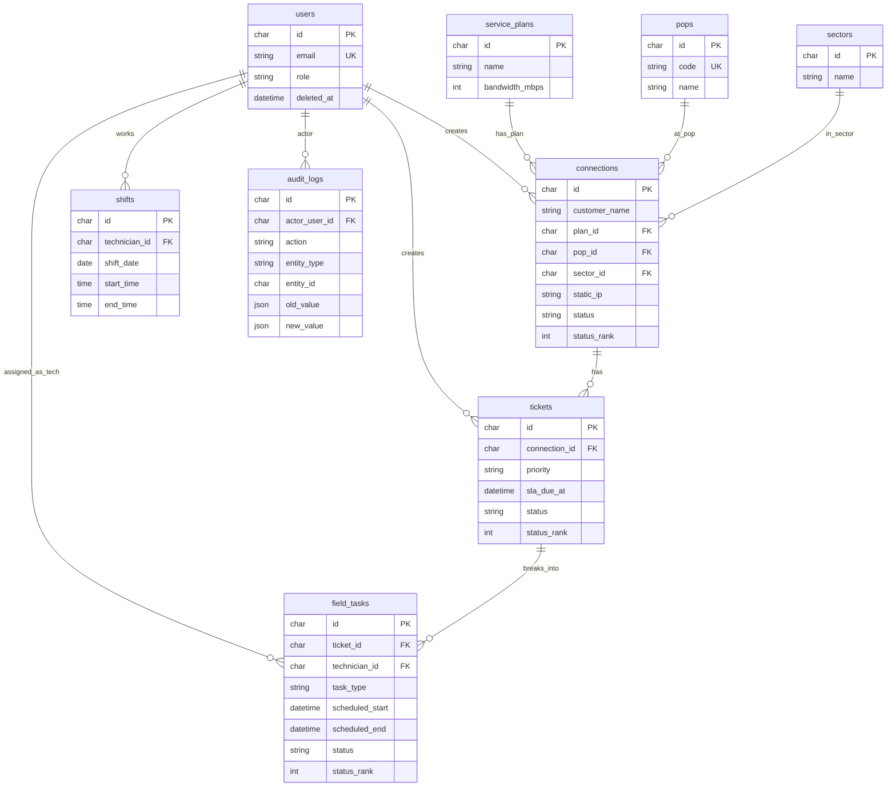

# ISP Operations & Field Dispatch API

Node.js + Express + MySQL backend for an Internet Service Provider operations engine.

Managers and support staff can register broadband connections, log complaints as master tickets, break work into field tasks, assign technicians with **schedule-conflict validation**, move ticket/task status with **status ranks**, and keep an **append-only audit trail**.

| | |
|---|---|
| Stack | Node.js 18+, Express 5, MySQL 8 |
| Auth | JWT (Bearer), Zod-validated login |
| Roles | `manager` · `support` · `technician` |
| Base URL | `/api/v1` |
| Hosted DB | Aiven MySQL (SSL) |
| Live API | https://revatix-assignment-api.onrender.com/api/v1 |
| Repo | https://github.com/Vibhor1603/revatix-assignment |

---

## Table of contents

1. [Features](#features)
2. [Quick start](#quick-start)
3. [Environment variables](#environment-variables)
4. [Test credentials](#test-credentials)
5. [Project structure](#project-structure)
6. [ER diagram](#er-diagram)
7. [Database schema](#database-schema)
8. [Indexes](#indexes)
9. [Status ranks](#status-ranks)
10. [Roles & permissions](#roles--permissions)
11. [API conventions](#api-conventions)
12. [API reference](#api-reference)
13. [Edge cases & how they are handled](#edge-cases--how-they-are-handled)
14. [Assign conflict algorithm](#assign-conflict-algorithm)
15. [Scripts](#scripts)
16. [Deploy (Render + Aiven)](#deploy-render--aiven)

---

## Features

- **Connections** — customer line + optional static IP + plan + POP + sector + deployment status
- **Catalog** — service plans, POPs (nodes), geographic sectors (hybrid lookup tables)
- **Tickets** — complaints with priority and SLA against a connection
- **Field tasks** — sub-jobs under a ticket; one technician per task (multiple techs = multiple tasks)
- **Shifts** — same-day windows only; overlapping shifts rejected
- **Dispatch** — assign / reassign / unassign / cancel with backend conflict checks
- **Status ranks** — ticket/task workflow stages stored with numeric rank in MySQL
- **Audit log** — every important mutation appends one independent row (filterable)

---

## Quick start

### Prerequisites

- Node.js 18+
- MySQL 8 (local Docker **or** Aiven)

### Local Docker MySQL

```bash
docker run --name isp-mysql \
  -e MYSQL_ROOT_PASSWORD=root \
  -e MYSQL_DATABASE=isp_ops \
  -p 3306:3306 -d mysql:8

cp .env.example .env
# For local Docker keep DB_SSL=false and DB_* as in .env.example

npm install
npm run db:schema
npm run seed
npm run dev
```

API: `http://localhost:4000/api/v1`

### Aiven MySQL

```bash
cp .env.example .env
# Fill Aiven host/port/user/password/database
# Set DB_SSL=true

npm install
npm run db:schema
npm run seed
npm run dev
```

---

## Environment variables

Copy `.env.example` → `.env` (never commit `.env`).

| Variable | Example | Notes |
|----------|---------|--------|
| `PORT` | `4000` | Local port (Render sets its own) |
| `NODE_ENV` | `development` | |
| `DB_HOST` | `127.0.0.1` or Aiven host | |
| `DB_PORT` | `3306` | Aiven often uses a custom port |
| `DB_USER` | `root` / `avnadmin` | |
| `DB_PASSWORD` | — | Secret |
| `DB_NAME` | `isp_ops` / `defaultdb` | |
| `DB_SSL` | `true` / `false` | **Required `true` on Aiven** |
| `DB_SSL_CA` | `./ca.pem` | Optional Aiven CA path |
| `JWT_SECRET` | long random string | Required in production |
| `JWT_EXPIRES_IN` | `8h` | |

---

## Test credentials

Seeded by `npm run seed` (password for all: `Password123!`):

| Email | Role |
|-------|------|
| `manager@isp.local` | manager |
| `support@isp.local` | support |
| `tech@isp.local` | technician |

No public register endpoint — seed / manager-created technicians only.

---

## Project structure

```
src/
  app.js / server.js
  config/env.js
  db/pool.js, ssl.js, query.js
  constants/roles.js, statuses.js
  middleware/   auth, requireRole, validate, errors
  routes/       /api/v1 modules
  controllers/
  services/     business rules + SQL
  validators/   Zod schemas
  utils/        AppError, audit, pagination, asyncHandler
  seed/seed.js
sql/schema.sql
scripts/        apply-schema, verify-api, curl-sweep
```

---

## ER diagram



**Notes**

- Technicians are `users` with `role = technician` (no separate technicians table).
- Sector is **independent** of POP; a connection references both.
- Soft delete via `deleted_at` (NULL = active).
- Times are stored as provided (IST as-is); no UTC conversion layer.

---

## Database schema

Full DDL: [`sql/schema.sql`](sql/schema.sql)

| Table | Purpose |
|-------|---------|
| `users` | Auth identities + roles |
| `service_plans` | Bandwidth plans |
| `pops` | Network nodes / Points of Presence |
| `sectors` | Geographic areas for field routing |
| `connections` | Subscriber lines (+ customer fields on the row) |
| `tickets` | Master complaints |
| `field_tasks` | Dispatch sub-tasks under a ticket |
| `shifts` | Technician duty windows |
| `audit_logs` | Append-only history |

---

## Indexes

| Table | Index | Why |
|-------|--------|-----|
| `users` | UNIQUE(`email`) | Login |
| `users` | (`role`, `deleted_at`) | List technicians |
| `pops` | UNIQUE(`code`) | Stable POP codes |
| `service_plans` / `sectors` | (`deleted_at`) | Active lists |
| `connections` | (`status`), (`plan_id`), (`pop_id`), (`sector_id`), (`deleted_at`) | Filters |
| `tickets` | (`connection_id`), (`status`), (`deleted_at`) | Lists / guards |
| `field_tasks` | (`ticket_id`) | Tasks per ticket |
| `field_tasks` | (`technician_id`, `scheduled_start`, `scheduled_end`) | Overlap checks |
| `field_tasks` | (`status`), (`deleted_at`) | Close-ticket / filters |
| `shifts` | (`technician_id`, `shift_date`) | Assign shift lookup |
| `audit_logs` | (`entity_type`, `entity_id`, `created_at`) | History by entity |
| `audit_logs` | (`action`), (`actor_user_id`), (`created_at`) | Filtered audit |

---

## Status ranks

### Connection

| Status | Rank |
|--------|------|
| Pending | 1 |
| Active | 2 |
| Suspended | 3 |
| Terminated | 4 |

Any transition is allowed; `status_rank` is always updated from a single map.

### Ticket

| Status | Rank |
|--------|------|
| Open | 1 |
| In-Progress | 2 |
| Field Visit | 3 |
| Resolved | 4 |
| Closed | 5 |

### Task

Same as ticket, plus **Cancelled = 6**.

Closing a **ticket** is blocked while any task is still Open / In-Progress / Field Visit / Resolved.

---

## Roles & permissions

| Action | manager | support | technician |
|--------|---------|---------|------------|
| Plans / POPs / sectors write | yes | — | — |
| Plans / POPs / sectors read | yes | yes | — |
| Connections write | yes | — | — |
| Connections read | yes | yes | — |
| Tickets create / update / status | yes | yes | — |
| Tickets read | yes | yes | yes |
| Tasks create / assign / unassign / cancel | yes | yes | — |
| Task status update | yes | yes | own assigned only |
| Create technician user | yes | — | — |
| Shifts write | yes | — | — |
| Shifts read | yes | yes | own |
| Audit read | yes | yes | — |

---

## API conventions

**Base path:** `/api/v1`

**Auth header**

```http
Authorization: Bearer <jwt>
```

**Success** — raw JSON body. Creates return `201`.

**List envelope**

```json
{
  "items": [],
  "page": 1,
  "pageSize": 10,
  "total": 0
}
```

**Error**

```json
{
  "error": "Validation Error",
  "message": "Validation failed",
  "details": [{ "path": "email", "message": "Invalid email" }]
}
```

| Code | Meaning |
|------|---------|
| 400 | Validation / business rule |
| 401 | Missing or invalid JWT / bad login |
| 403 | Role not allowed |
| 404 | Entity not found |
| 409 | Conflict (e.g. duplicate POP code) |

---

## API reference

### Auth

| Method | Path | Auth | Purpose |
|--------|------|------|---------|
| POST | `/auth/login` | public | Issue JWT |
| GET | `/auth/me` | JWT | Current user |

**POST `/auth/login`**

Request:

```json
{ "email": "manager@isp.local", "password": "Password123!" }
```

Response `200`:

```json
{
  "token": "<jwt>",
  "user": {
    "id": "uuid",
    "name": "Ops Manager",
    "email": "manager@isp.local",
    "role": "manager",
    "employeeCode": null,
    "createdAt": "..."
  }
}
```

DB: `SELECT` user by email → bcrypt compare → sign JWT (`HS256`).

---

### Plans `/plans`

| Method | Path | Roles | Purpose | DB |
|--------|------|-------|---------|-----|
| POST | `/plans` | manager | Create plan | INSERT + audit `plan_created` |
| GET | `/plans?page=` | manager, support | List | SELECT page |
| GET | `/plans/:id` | manager, support | Detail | SELECT |
| PATCH | `/plans/:id` | manager | Update | UPDATE + audit `plan_updated` |
| DELETE | `/plans/:id` | manager | Soft delete | `deleted_at` + audit `plan_deleted` |

**POST body**

```json
{ "name": "Fiber 100", "bandwidthMbps": 100, "price": 999 }
```

---

### POPs `/pops`

| Method | Path | Roles | Purpose | DB |
|--------|------|-------|---------|-----|
| POST | `/pops` | manager | Create POP | INSERT + audit |
| GET | `/pops` | manager, support | List | SELECT |
| GET | `/pops/:id` | manager, support | Detail | SELECT |
| PATCH | `/pops/:id` | manager | Update | UPDATE + audit |
| DELETE | `/pops/:id` | manager | Soft delete | UPDATE + audit |

**POST body**

```json
{ "code": "POP-BLR-01", "name": "Bangalore Hub 1", "location": "Bengaluru" }
```

Duplicate `code` → `409`.

---

### Sectors `/sectors`

Same CRUD pattern as plans (independent of POP).

**POST body**

```json
{ "name": "Koramangala East", "geoDescription": "East routing" }
```

---

### Connections `/connections`

| Method | Path | Roles | Purpose | DB |
|--------|------|-------|---------|-----|
| POST | `/connections` | manager | Register line | Validate FKs → INSERT + audit `connection_created` |
| GET | `/connections` | manager, support | List/filter | JOIN plan/pop/sector |
| GET | `/connections/:id` | manager, support | Detail | JOIN |
| PATCH | `/connections/:id` | manager | Update fields | UPDATE; audit `plan_change` if plan changes else `connection_updated` |
| PATCH | `/connections/:id/status` | manager | Change status | UPDATE status+rank + audit `status_change` |
| DELETE | `/connections/:id` | manager | Soft delete | UPDATE + audit |

**Query filters:** `page`, `status`, `planId`, `popId`, `sectorId`

**POST body**

```json
{
  "customerName": "Ada Lovelace",
  "phone": "9876543210",
  "email": "ada@example.com",
  "address": "12 Example St",
  "planId": "uuid",
  "popId": "uuid",
  "sectorId": "uuid",
  "staticIp": "10.0.0.5",
  "status": "Active"
}
```

`staticIp` optional. Default status `Pending`.

---

### Tickets `/tickets`

| Method | Path | Roles | Purpose | DB |
|--------|------|-------|---------|-----|
| POST | `/tickets` | manager, support | Create complaint | Block Terminated connection → INSERT + audit |
| GET | `/tickets` | manager, support, technician | List | SELECT |
| GET | `/tickets/:id` | same | Detail (no embedded tasks) | SELECT |
| PATCH | `/tickets/:id` | manager, support | Update meta | UPDATE + audit |
| PATCH | `/tickets/:id/status` | manager, support | Workflow | Block Close if open tasks → UPDATE rank + audit |

**POST body**

```json
{
  "connectionId": "uuid",
  "title": "Speed degradation",
  "description": "Evenings only",
  "complaintType": "speed_degradation",
  "priority": "high",
  "slaDueAt": "2026-10-24 18:00:00"
}
```

**Query:** `page`, `status`, `connectionId`, `priority`

---

### Tasks

| Method | Path | Roles | Purpose | DB |
|--------|------|-------|---------|-----|
| POST | `/tickets/:ticketId/tasks` | manager, support | Add field task | INSERT + audit `task_created` |
| GET | `/tickets/:ticketId/tasks` | manager, support, technician | List | SELECT |
| GET | `/tasks/:id` | same | Detail | SELECT |
| PATCH | `/tasks/:id` | manager, support | Update type/desc | UPDATE + audit |
| PATCH | `/tasks/:id/status` | manager, support; tech if assignee | Status + rank | UPDATE + audit |
| POST | `/tasks/:id/assign` | manager, support | Assign / reassign | Transaction + conflict checks + audit |
| POST | `/tasks/:id/unassign` | manager, support | Clear tech | UPDATE + audit `task_unassigned` |
| POST | `/tasks/:id/cancel` | manager, support | Cancel | status Cancelled + audit |

**Create body**

```json
{ "taskType": "Feeder Line Check", "description": "Check feeder" }
```

`taskType` is a free string (e.g. Feeder Line Check, ONU Configuration, Splicing).

**Assign body**

```json
{
  "technicianId": "uuid",
  "scheduledStart": "2026-10-24 10:00:00",
  "scheduledEnd": "2026-10-24 12:00:00"
}
```

---

### Technicians & shifts `/technicians`

| Method | Path | Roles | Purpose | DB |
|--------|------|-------|---------|-----|
| GET | `/technicians` | manager, support | List tech users | SELECT role=technician |
| POST | `/technicians` | manager | Create tech user | INSERT users + audit |
| POST | `/technicians/:id/shifts` | manager | Add shift | Reject overnight/overlap → INSERT |
| GET | `/technicians/:id/shifts` | manager, support; tech self | List | SELECT |
| DELETE | `/technicians/:id/shifts/:shiftId` | manager | Soft delete shift | UPDATE + audit |

**Shift body**

```json
{
  "shiftDate": "2026-10-24",
  "startTime": "09:00:00",
  "endTime": "17:00:00"
}
```

---

### Audit `/audit`

| Method | Path | Roles | Purpose | DB |
|--------|------|-------|---------|-----|
| GET | `/audit` | manager, support | Filter history | SELECT only (append-only) |

**Query:** `page`, `entityType`, `entityId`, `action`, `actorUserId`

Example actions: `connection_created`, `plan_change`, `status_change`, `task_assigned`, `task_reassigned`, `task_unassigned`, `task_cancelled`, `shift_created`, …

---

## Edge cases & how they are handled

| Case | Behaviour |
|------|-----------|
| Bad login password | `401` generic message |
| Invalid login body (Zod) | `400` + `details` |
| Missing / bad / expired JWT | `401` |
| Soft-deleted user | Cannot authenticate |
| Wrong role | `403` |
| Unknown UUID | `404` |
| Duplicate POP code | `409` |
| Missing plan/pop/sector on connection create | `404` from lookup |
| Ticket on Terminated connection | `400` |
| Ticket on missing connection | `404` |
| Technician creates ticket/task | `403` |
| Close ticket while tasks still open | `400` |
| Overnight shift (`end <= start`) | `400` |
| Overlapping shifts same day | `400` |
| Assign outside shift | `400` |
| Assign overlapping active tasks | `400` |
| Assign spanning midnight | `400` |
| Overlap with Closed/Cancelled task | Allowed (ignored) |
| Reassign different technician | Allowed; audit `task_reassigned` |
| SQL injection | Parameterized queries only (`mysql2`) |
| Prompt / junk input on login | Zod email + password constraints |

---

## Assign conflict algorithm

Runs in a **MySQL transaction**:

1. Lock/load task  
2. Load technician (`role = technician`, not deleted)  
3. Same calendar day; `scheduledEnd` > `scheduledStart`  
4. Require a shift covering the slot  
5. Reject overlap with other tasks where status ∉ {Closed, Cancelled}  
6. On success: UPDATE assignment + audit (`task_assigned` / `task_reassigned`)  
7. On failure: rollback + clear `400` message  

---

## Scripts

| Command | Purpose |
|---------|---------|
| `npm run dev` | Nodemon local server |
| `npm start` | Production start |
| `npm run db:schema` | Apply `sql/schema.sql` (SSL-aware) |
| `npm run seed` | Seed users + sample catalog |
| `npm run verify` | Automated API checks |
| `bash scripts/curl-sweep.sh` | Full curl happy-path + edges |

---

## Deploy (Render + Aiven)

1. Aiven MySQL is already usable with `DB_SSL=true`.
2. Create a **Web Service** on Render (Node), connect this GitHub repo.
3. Set env vars: `DB_HOST`, `DB_PORT`, `DB_USER`, `DB_PASSWORD`, `DB_NAME`, `DB_SSL=true`, `JWT_SECRET`, `JWT_EXPIRES_IN=8h`, `NODE_ENV=production`.
4. Build: `npm install` · Start: `npm start`.
5. Blueprint stub: [`render.yaml`](render.yaml).

Optional: download Aiven CA → set `DB_SSL_CA` for full certificate verification.

---

## License

ISC
